<a id="top"></a>

<div align="center"> <a href="README.md">
    
  </a>
  <a href="README.id.md">
    
  </a>
  

<h2 align="center">Daftar Isi</h2>

<p align="center">
  <a href="#about"></a>
  <a href="#approach"></a>
  <a href="#projects"></a>
  <a href="#technology-stack"></a>
</p>
<p align="center">
  <a href="#github-analytics"></a>
  <a href="#collaboration"></a>
  <a href="#guestbook"></a>
</p>

</div><a id="about"></a>

<div align="left"><h2><code>kiisafezone:~$ about</code></h2></div><div align="center">
  
</div><a id="approach"></a>

<div align="left"><h2><code>kiisafezone:~$ approach</code></h2></div><div align="center">
  
</div><br /><a id="projects"></a>

<div align="left"><h2><code>kiisafezone:~$ projects</code></h2></div><div align="center"><a href="https://github.com/kiisafezone/aisa-OopsAllBugs">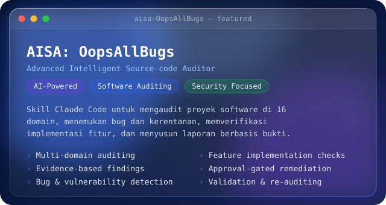</a>

<a href="https://github.com/kiisafezone/usahaos"></a>
<a href="https://github.com/kiisafezone/larashris"></a>
<a href="https://github.com/kiisafezone/relache-app"></a>
<a href="https://github.com/kiisafezone/livexis"></a>
<a href="https://github.com/kiisafezone/nospotify-hybrid"></a>

<br /></div><a id="technology-stack"></a>

<div align="left"><h2><code>kiisafezone:~$ stack</code></h2></div><div align="center">
  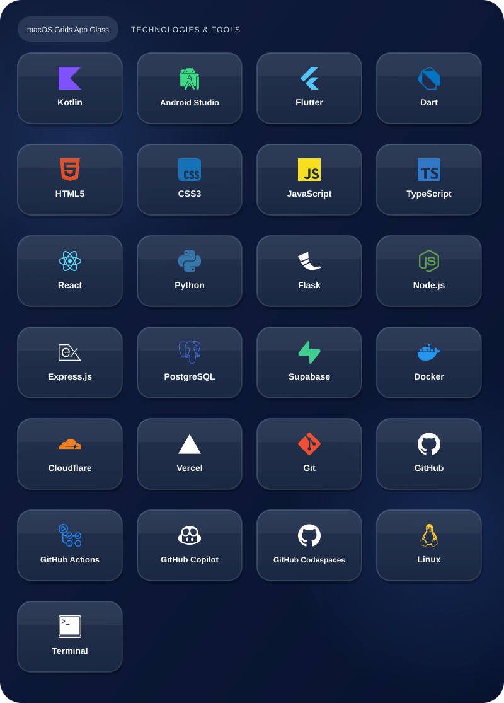
</div>

<a id="github-analytics"></a>

<div align="left"><h2><code>kiisafezone:~$ analytics</code></h2></div><div align="center">
</div><a name="collaboration"></a>

<div align="left"><h2><code>kiisafezone:~$ connect</code></h2></div>Saya terbuka untuk kolaborasi terarah membuat perangkat open-source, software yang aman, dan otomasi praktis.

<div align="center"><a href="https://github.com/kiisafezone"></a>
<a href="https://github.com/kiisafezone?tab=repositories"></a>

</div><a id="guestbook"></a>

<div align="left"><h2><code>kiisafezone:~$ guestbook</code></h2></div>```text
# Sapa, ceritakan yang sedang kamu bangun, atau tinggalkan pesan.
# Setiap entri akan membuat issue publik di repo ini.
```

<div align="center"><a href="https://github.com/kiisafezone/kiisafezone/issues/new?template=guestbook.yml"></a>
<a href="https://github.com/kiisafezone/kiisafezone/issues?q=label%3Aguestbook"></a>
<a href="https://github.com/sponsors/kiisafezone"></a>

<br /><br />

<a href="#top">
  
</a><br /><a href="#top">
  
</a></div>
