<div align="center">


<a href="#about"><code>about</code></a> ·
<a href="#projects"><code>projects</code></a> ·
<a href="#technology-stack"><code>stack</code></a> ·
<a href="#github-analytics"><code>analytics</code></a> ·
<a href="#collaboration"><code>collaboration</code></a> ·
<a href="#guestbook"><code>guestbook</code></a> ·
<a href="#connect"><code>connect</code></a>


</div>

<a id="about"></a>

<div align="center">
## ~/about


</div>

<div align="center">

</div>

<br />

I'm an independent software developer and open-source creator interested in building practical software, developing engineering tools, and improving software quality.

My work sits at the intersection of software engineering, application security, automation, and modern development technologies. I believe software should be more than functional: it should be reliable, maintainable, secure, and genuinely useful.

```python
class KiiSafeZone:
    """Independent developer. Builds, audits, and ships practical software."""

    focus = [
        "Software engineering & architecture",
        "Application security & vulnerability analysis",
        "Software quality assurance",
        "AI-assisted development & automation",
        "Full-stack and Android development",
    ]

    stack = {
        "mobile":  ["Kotlin", "Flutter"],
        "web":     ["React", "TypeScript", "Node.js"],
        "backend": ["Python / Flask", "Express", "PostgreSQL", "Supabase"],
        "infra":   ["Docker", "Cloudflare", "Vercel", "GitHub Actions", "Linux"],
    }

    speaks  = ["Indonesian (native)", "English"]
    open_to = ["Open source", "Joint projects", "Security & quality reviews"]
```

<div align="center">
## ~/approach


</div>

<div align="center">

</div>

<br />

<a id="projects"></a>

<div align="center">
## ~/projects


</div>

<div align="center">

<a href="https://github.com/kiisafezone/aisa-OopsAllBugs"></a>

<a href="https://github.com/kiisafezone/usahaos"></a>
<a href="https://github.com/kiisafezone/larashris"></a>
<a href="https://github.com/kiisafezone/relache-app"></a>
<a href="https://github.com/kiisafezone/livexis"></a>
<a href="https://github.com/kiisafezone/nospotify-hybrid"></a>

<br />

<a href="https://github.com/kiisafezone?tab=repositories"></a>

</div>

<a id="technology-stack"></a>

<div align="center">
## ~/stack


</div>

| | |
|:--|:--|
| <code>mobile</code> |  |
| <code>web</code> |  |
| <code>backend</code> |  |
| <code>data</code> |  |
| <code>infra</code> |  |

<a id="github-analytics"></a>

<div align="center">
## ~/analytics


</div>

<div align="center">


</div>

<a id="collaboration"></a>

<div align="center">
## ~/collaboration


</div>

I'm open to connecting with developers, engineers, researchers, maintainers, and organizations interested in building useful software.

```yaml
interested_in:
  - Open-source development and joint projects
  - Software architecture and engineering
  - Application security and code quality
  - AI-powered developer tools
  - Automation and engineering workflows
  - Technical research and knowledge exchange
```

Whether you're developing an interesting product, maintaining an open-source project, or exploring a technical challenge, I'm open to discussing potential collaboration.

<a id="guestbook"></a>

<div align="center">
## ~/guestbook


</div>

```text
# Drop a hello, share what you're building, or leave a note.
# Each entry opens a public issue on this repo.
```

<div align="center">

<a href="https://github.com/kiisafezone/kiisafezone/issues/new?template=guestbook.yml"></a>
<a href="https://github.com/kiisafezone/kiisafezone/issues?q=label%3Aguestbook"></a>

</div>

<a id="connect"></a>

<div align="center">
## ~/connect


</div>

<div align="center">

<a href="https://github.com/kiisafezone"></a>
<a href="https://github.com/kiisafezone?tab=repositories"></a>

<!-- Add email, LinkedIn, or Telegram buttons here when ready -->

<br /><br />



</div>
