<a id="top"></a>

<p align="center"><a href="README.md">English</a> · <a href="README.id.md">Bahasa Indonesia</a></p>

<div align="center">


<a href="#about"><code>about</code></a> ·
<a href="#projects"><code>projects</code></a> ·
<a href="#technology-stack"><code>stack</code></a> ·
<a href="#collaboration"><code>collaboration</code></a> ·
<a href="#guestbook"><code>guestbook</code></a>


</div>

<a id="about"></a>

<h3 align="center">~/about</h3>

<div align="center">

</div>

<div align="center">

</div>

<a id="approach"></a>

<h3 align="center">~/approach</h3>

<div align="center">

</div>

<div align="center">

</div>

<br />

<a id="projects"></a>

<h3 align="center">~/projects</h3>

<div align="center">

</div>

<div align="center">

<a href="https://github.com/kiisafezone/aisa-OopsAllBugs"></a>

<a href="https://github.com/kiisafezone/usahaos"></a>
<a href="https://github.com/kiisafezone/larashris"></a>
<a href="https://github.com/kiisafezone/relache-app"></a>
<a href="https://github.com/kiisafezone/livexis"></a>
<a href="https://github.com/kiisafezone/nospotify-hybrid"></a>

<br />

</div>

<a id="technology-stack"></a>

<h3 align="center">~/stack</h3>

<div align="center">

</div>

<table width="100%">
  <tr><td><code>mobile</code></td><td></td></tr>
  <tr><td><code>web</code></td><td></td></tr>
  <tr><td><code>backend</code></td><td></td></tr>
  <tr><td><code>data</code></td><td></td></tr>
  <tr><td><code>infra</code></td><td></td></tr>
</table>

<a id="collaboration"></a>

<h3 align="center">~/collaboration &amp; connect with me</h3>

<div align="center">

</div>

I welcome focused collaborations on open-source tools, secure software, and practical automation.

<div align="center">
<a href="https://github.com/kiisafezone"></a>
<a href="https://github.com/kiisafezone?tab=repositories"></a>
</div>

<a id="guestbook"></a>

<h3 align="center">~/guestbook</h3>

<div align="center">

</div>

```text
# Drop a hello, share what you're building, or leave a note.
# Each entry opens a public issue on this repo.
```

<div align="center">

<a href="https://github.com/kiisafezone/kiisafezone/issues/new?template=guestbook.yml"></a>
<a href="https://github.com/kiisafezone/kiisafezone/issues?q=label%3Aguestbook"></a>
<a href="https://github.com/sponsors/kiisafezone"></a>

</div>

<div align="center"><a href="#top"></a>
<br />
<a href="#top">↑ Back to top</a></div>
