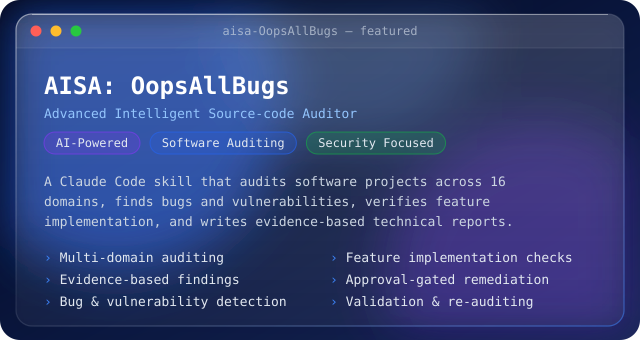

<a id="top"></a>

<p align="center">
  <a href="README.md">
    
  </a>
  <a href="README.id.md">
    
  </a>
</p>

<div align="center">




<!--  -->

<a href="#about"><code>about</code></a> ·
<a href="#projects"><code>projects</code></a> ·
<a href="#technology-stack"><code>stack</code></a> ·
<a href="#github-analytics"><code>analytics</code></a> ·
<a href="#collaboration"><code>collaboration</code></a> ·
<a href="#guestbook"><code>guestbook</code></a>


</div>

<a id="about"></a>

<div align="center">
## ~/about


</div>

<div align="center">

</div>

<div align="center">
## ~/approach


</div>

<div align="center">

</div>

<br />

<a id="projects"></a>

<div align="center">
## ~/projects


</div>

<div align="center">

<a href="https://github.com/kiisafezone/aisa-OopsAllBugs"></a>

<a href="https://github.com/kiisafezone/usahaos"></a>
<a href="https://github.com/kiisafezone/larashris"></a>
<a href="https://github.com/kiisafezone/relache-app"></a>
<a href="https://github.com/kiisafezone/livexis"></a>
<a href="https://github.com/kiisafezone/nospotify-hybrid"></a>

<br />

</div>

<a id="technology-stack"></a>

<div align="center">
## ~/stack


</div>

<table width="100%">
  <tr><td><code>mobile</code></td><td></td></tr>
  <tr><td><code>web</code></td><td></td></tr>
  <tr><td><code>backend</code></td><td></td></tr>
  <tr><td><code>data</code></td><td></td></tr>
  <tr><td><code>infra</code></td><td></td></tr>
</table>

<a id="github-analytics"></a>

<div align="center">
## ~/analytics


</div>

<div align="center">
<!--


-->
</div>

<a name="collaboration"></a>

<div align="center">
## ~/collaboration & connect with me


</div>

I welcome focused collaborations on open-source tools, secure software, and practical automation.

<div align="center">
<a href="https://github.com/kiisafezone"></a>
<a href="https://github.com/kiisafezone?tab=repositories"></a>
</div>

<a id="guestbook"></a>

<div align="center">
## ~/guestbook


</div>

```text
# Drop a hello, share what you're building, or leave a note.
# Each entry opens a public issue on this repo.
```
<p align="center">
  <a href="#about"></a>
  <a href="#approach"></a>
  <a href="#projects"></a>
  <a href="#technology-stack"></a>
  <a href="#github-analytics"></a>
  <a href="#collaboration"></a>
  <a href="#guestbook"></a>
</p>

<div align="center">

<a href="https://github.com/kiisafezone/kiisafezone/issues/new?template=guestbook.yml"></a>
<a href="https://github.com/kiisafezone/kiisafezone/issues?q=label%3Aguestbook"></a>
<a href="https://github.com/sponsors/kiisafezone"></a>
