**Engineering Ideas Into Practical Software.**

Building · Auditing · Improving · Collaborating

[About](#about) · [Projects](#projects) · [Tech Stack](#technology-stack) · [Analytics](#github-analytics) · [Collaboration](#collaboration)

---

## About Me

I'm an independent software developer and open-source creator interested in building practical software, developing engineering tools, and improving software quality.

My work sits at the intersection of software engineering, application security, automation, and modern development technologies. I believe software should be more than functional: it should be reliable, maintainable, secure, and genuinely useful.

**Areas of interest**

- Software engineering & architecture
- Application security & vulnerability analysis
- Software quality assurance
- AI-assisted development & automation
- Full-stack and Android application development

**Approach**

| 01 · Research | 02 · Design | 03 · Build | 04 · Audit | 05 · Validate | 06 · Improve |
|:---:|:---:|:---:|:---:|:---:|:---:|
| Understand the problem and constraints | Plan architecture and data flow | Implement in small, testable steps | Review code, security, and quality | Verify fixes with evidence | Refine and iterate |

**Languages**

---

## Projects & Development

Projects focused on practical solutions, software engineering, and developer productivity.

### Featured Project

<table>
<tr>
<td width="100%">

<h3>AISA: OppsAllBugs</h3>

<b>Advanced Intelligent Source-code Auditor</b>

An advanced Claude Code skill designed to audit software projects across 16 domains, identify bugs and vulnerabilities, verify feature implementation, and produce evidence-based technical reports.

<b>Core capabilities:</b>

<ul>
<li>Multi-domain software auditing</li>
<li>Evidence-based findings</li>
<li>Bug and vulnerability identification</li>
<li>Feature implementation verification</li>
<li>Optional approval-gated remediation</li>
<li>Validation and re-auditing</li>
</ul>

</td>
</tr>
</table>

### Featured Projects

---

## Technology Stack

---

## GitHub Analytics

---

## Collaboration

### Let's Build Something Meaningful.

I'm open to connecting with developers, engineers, researchers, maintainers, and organizations interested in building useful software.

I'm particularly interested in:

- Open-source development and joint projects
- Software architecture and engineering
- Application security and code quality
- AI-powered developer tools
- Automation and engineering workflows
- Technical research and knowledge exchange

Whether you're developing an interesting product, maintaining an open-source project, or exploring a technical challenge, I'm open to discussing potential collaboration.

<h2><b>Open to Ideas. Open to Collaboration. Always Building.</b></h2>

